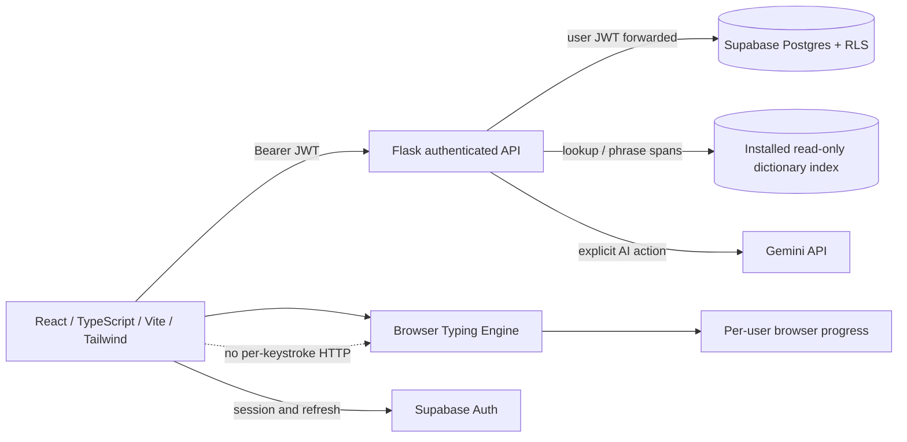
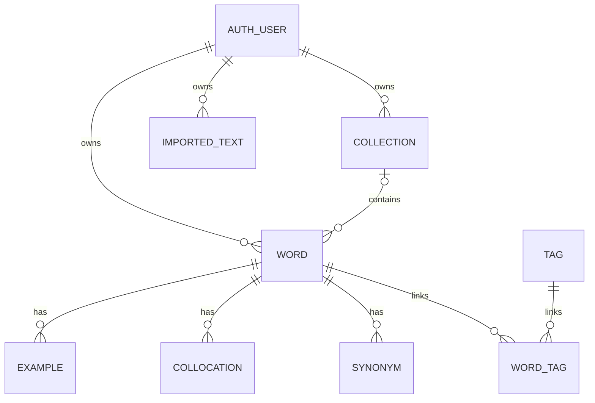

# VOCA architecture

Living reference, inspected against this feature branch on 2026-11-01. Current code
and observed runtime take precedence over older plans. Read `AGENTS.md` first.

Status vocabulary: **As-Is — Implemented** means inspected source exists;
**To-Be — Approved, not yet implemented** means an accepted requirement remains;
**Proposed — Under consideration** is not a decision; **Unknown — Not verified**
marks an evidence gap. Implementation status does not imply live verification.

## Purpose and system boundaries

VOCA connects contextual reading, personal vocabulary/collections and active
recall. File imports supply existing vocabulary data; article imports optionally
extract candidates with AI; Reading & Typing practices transcription with local
dictionary lookup. Copy accuracy never updates recall scores or SRS mastery.



## Stack, runtime and deployment

**As-Is — Implemented:** React 18, TypeScript, React Router 7, Vite 6,
Tailwind 4, Lucide, Recharts, Supabase JS; Python/Flask, Flask-CORS,
Supabase Python, google-generativeai, zstandard for modern APKG. Python 3.12
was used for this branch; Node 22.18+ or newer is needed for built-in TypeScript
unit tests (verified with Node 25).

Frontend builds to `frontend/dist`; existing Vercel config serves the SPA.
Backend is an independently hosted Flask service (existing Cloud Run/Docker
configuration). `docker-compose.yml` and existing Dockerfiles are preserved.
No deployment or infrastructure configuration was changed.

**Unknown — Not verified:** current production backend revision and deployed
Supabase schema/RLS. Vercel read-only metadata confirmed `voca118.vercel.app`
points to `30f343f8494e7066c1defd374810017c4ac9da5e` on `main`, rather than
this feature branch. Feature-branch pushes are backups, not production releases.

## Frontend structure and routes

`frontend/src/app/App.tsx` owns routing, wrapped by `AuthProvider`.
`MainLayout.tsx` gates protected screens on a Supabase session and provides
responsive navigation and top bar. No new authentication bypass is installed.

| Routes | Screens / responsibility | Status |
| --- | --- | --- |
| `/login` | Existing public landing and Google login | As-Is |
| `/` | Dashboard | As-Is |
| `/vocabulary`, `/vocabulary/new`, `/vocabulary/:id` | Library, manual entry, details/editing | As-Is |
| `/collections`, `/collections/:id` | Collections and words | As-Is |
| `/import`, `/import/step1`–`step3` | Article capture, candidate selection, review/save | As-Is |
| `/import/files` | Independent structured file/list wizard | As-Is, new |
| `/practice`, `/practice/:articleId` | Persistent article library and inline typing | As-Is, new |
| `/review`, `/review/session`, `/review/result` | Recall configuration, session and result | As-Is |
| `/statistics`, `/settings` | Existing statistics/settings; separate local typing summary | As-Is |

Screen state uses React hooks and route state. `contexts/AuthContext.tsx` owns
session/user identity. `lib/api.ts` owns API base URL, bearer forwarding and one
401 refresh/retry; JSON and FormData headers differ. `lib/fileImport.ts`,
`lib/dictionary.ts` and `lib/articles.ts` provide typed feature contracts.
No duplicate global state framework was introduced.

## Flask and API responsibilities

`backend/app.py:create_app` sets CORS, health, the existing authentication hook
and route blueprints. `services/supabase_client.py` creates a request-authenticated
Supabase client using `g.token`. New code uses explicit `g.user_id` filters as well
as the existing RLS boundary. Unknown schema/connectivity failures remain visible.

| API prefix | Owner | Responsibility |
| --- | --- | --- |
| `/api/words`, `/collections`, `/tags` | Existing route modules | User vocabulary and relationships |
| `/api/import` | `routes/import_text.py` | Explicit AI text/image/PDF extraction and typo checking |
| `/api/ai` | `routes/ai.py`, `services/ai_service.py` | User-requested enrichment |
| `/api/review`, `/stats`, `/export` | Existing route modules | Recall/SRS, reporting, exports |
| `/api/file-import` | `routes/file_import.py` | Parse → preview → idempotent batch commit |
| `/api/dictionary` | `routes/dictionary.py` | Installed word/form/phrase lookup, no AI fallback |
| `/api/articles` | `routes/articles.py` | List, get and safely retry article creation |

New contracts: `POST /file-import/parse` accepts multipart file or JSON text,
delimiter/header settings; `/preview` and `/commit` accept mapped rows,
`import_id`, default language, collection ID and `skip|keep_both` conflict policy.
Results identify every row's ready/invalid/skipped/imported/resumed/failed status.
`GET /dictionary?q=&language=` returns senses, lemma, IPA, translations,
collocations, source/license, cache and installation status. `POST /dictionary/phrases`
accepts text/language and returns longest non-overlapping Unicode code-point spans.
`GET /articles` returns `{items}`; `GET /articles/:id` and `POST /articles` return
an article (`id,title,raw_text,language,source_type,created_at`).

## Schema, entities, authorization

**As-Is — Inspected schema definitions:** `supabase/migrations/20240101000000_initial_schema.sql`
defines user-owned `words`, `collections`, `tags`, `word_tags`, `examples`,
`collocations`, `synonyms`, `imported_text`, with auth-user foreign keys and RLS.
`backend/schema.sql` is older and omits user columns/RLS. The migration contains
destructive reset statements: it is historical evidence, not a safe migration command.
Do not execute it against an existing installation.



`words.collection_id` is one collection per word, not a many-to-many membership.
Deleting a collection is defined to set its words' collection reference to null.
`words` owns translation, definition, language, source and SRS fields
(`mastery`, `review_count`, `next_review`). Child rows also carry `user_id`.
`imported_text` owns complete article text. There is no article→word foreign key;
saved dictionary entries retain source/context as text. No application schema,
RLS or production auth change was applied by this branch.

**Unknown — Not verified:** live policies/columns and migrations applied. Existing
code uses `ipa`, absent from the checked-in initial migration. In-memory test
doubles validate API ownership behavior, not deployed RLS or schema compatibility.

## Vocabulary and collection flows

Existing CRUD remains authoritative. Structured import and dictionary saves append
Vocabulary words; Review reads those words. Imports never reset existing SRS,
silently overwrite definitions, or replace user translations. Default duplicates
are skipped; explicitly keeping both creates another item. Collection ownership
is checked before new import writes. Concurrent independent imports/saves can still
race because no normalized word/language uniqueness constraint exists.

## Independent import architecture

**As-Is — Implemented:** `services/file_parser.py` uses Python csv for CSV/TSV/Anki
TXT (UTF-8/BOM, quotes, multiline, directives, optional/manual headers). APKG uses
bounded ZIP reads and read-only SQLite, with zstandard for `.anki21b`; note fields,
tags and deck names are converted to plain text. No filesystem extraction or
template/HTML execution; media and Anki scheduling are excluded with warnings.

Limits: 10 MiB upload, 12 MiB request, 100 MiB decoded collection DB, 250 MiB
archive total, 10,000 rows, 64 columns, 20,000 characters per cell. SQL work has a
progress budget. Mixed/custom note types remain manually mappable rather than
claimed universally compatible.

`FileImport.tsx` owns upload/paste, mapping, destination/create collection,
duplicate policy, preview, confirmation, 100-row request batches, progress and
downloadable per-row reports. `file_import_service.py` checks existing user rows,
assigns deterministic UUIDs using user/import/row content, writes with
`ignore_duplicates`, reconciles uncertain writes, and repairs missing child
relations on retry. PostgREST child writes are separate transactions; errors are
reported as partial failures, not atomic success. Retrying the same payload/import
ID is safe. No AI module is used by this path.

## Article import and storage

Existing Step 1 explicitly calls AI when **Analyze Material with AI** or the
AI document-extraction action is chosen. Step 2 selects candidates; Step 3 reviews
and saves. Step 3's previous mount-time bulk enrichment was replaced by the
explicit **Enrich selected with AI** action. The original candidate/edit/save flow
remains. It still uses existing sequential word CRUD rather than the new file
import persistence contract.

**As-Is — Implemented:** Step 1's **Save for Reading & Typing** stores full text
without AI. The practice library also stores pasted articles. Deterministic
user/content article UUIDs make lost-response retries safe in `imported_text`.
Text remains in the form after a save failure. AI article extraction does not
automatically save a full article; the save action is explicit.

## Dictionary datasets and cache

**As-Is — Implemented:** `services/dictionary_service.py` queries a local read-only
SQLite index; this is a derived dictionary file, not another user-data store.
Priority is cached result → exact installed entry → dataset lemma/forms → verified
English suffix candidates → clear local miss. Phrases use the same installed
entries. Query paths perform no network downloads/model calls.

ECDICT supplies English/Chinese translations and forms; Kaikki English Wiktionary
German supplies German senses/forms, English glosses and available translations.
Open English WordNet was evaluated but not installed. See [DICTIONARY.md](DICTIONARY.md)
for source URLs, licenses, full installed counts, hashes, limitations and installer.
Raw sources and the generated ~613 MiB index are ignored by Git; a new clone runs
the explicit installer. The running backend never downloads data automatically.

Cache ownership is the resolver's bounded 2,048-entry process-local LRU, invalidated
by dictionary revision. Results are copied before returning. Public dictionary data
only: user content, AI output and SRS never enter this shared cache. AI results
remain selected-panel state; no persistent AI cache was introduced.

## Typing, rendering and learning progress

**As-Is — Implemented:** `lib/typingEngine.ts` owns pure input/metrics/restore logic;
`ArticleTypingSurface.tsx` renders Unicode character/word spans, feedback, caret,
paragraphs and scroll with a small invisible native input capture for keyboard/IME.
Paste/drop are disabled for copy practice. Input stays in the browser; word clicks
and Shift+click phrase selections do not overwrite progress. One phrase lookup per
article/chunk is separate from input processing. DictionaryPanel uses explicit
selection lookup, pronunciation and save; **Ask AI** is its only model-request path.

`TypingPractice.tsx` owns pause/start/restart, active time (idle stops after 10s),
WPM, copy accuracy, progress and article selection. Attempts include corrected
mistakes. Positions count Unicode code points consistently across Python and
`Array.from`. Local progress is versioned by user+article, validated against source
fingerprint, saved after a short debounce and pagehide; storage failures are visible.
Progress stores the latest attempt in the current browser, not cross-device history.

`TypingProgressSummary.tsx` derives Statistics' separate copy metrics from existing
article sources and browser progress. It does not persist shadow totals. Vocabulary
saves feed the existing Review queue, but transcription never submits review answers.
Existing Review updates SRS only from explicit recall ratings. Cross-device typing history remains a proposed product choice rather than delivered behavior.

## Error handling and security boundaries

New JSON boundaries validate objects/types/limits and return clear 400/413/503 errors.
File import CORS preflight passes without credentials; the actual request still uses
the existing authentication gate. Read-only dictionary failures remain visible,
without AI compensation. Archive path traversal, encrypted/oversized packages and
HTML execution are rejected or excluded. Authenticated user data is not written to
the dictionary. Existing credentials are never committed or copied into this branch.

## Tests and local execution

```bash
cd frontend
npm ci
npm run typecheck
npm run build
npm test
npm run test:e2e
```

```bash
cd backend
python3.12 -m venv .venv
.venv/bin/python -m pip install -r requirements.txt
.venv/bin/python -m unittest discover -s tests/unit -v
```

Playwright uses loopback-only Flask/Supabase auth/storage doubles defined in
`backend/tests/e2e/fixture_server.py`, the real React/Flask routes and installed
dictionary, and system Chrome. It does not use a production auth bypass or personal
JWT. Assertions intercept AI requests and exercise real keyboard/browser behavior.
Unit/API tests patch AI and outbound requests to prove ordinary lookup/import zero
model calls. Live authenticated Supabase/Google E2E remains **Unknown — Not verified**
without dedicated E2E credentials. See [DEVELOPMENT-LEDGER.md](DEVELOPMENT-LEDGER.md)
for executed checks/evidence, and [LOCAL-DEVELOPMENT.md](LOCAL-DEVELOPMENT.md) for
launch commands without editing existing secrets.

## Technical debt and open questions

- Existing Statistics has inferred/placeholder recall charts and accuracy; this
  branch's typing summary is independently labeled and measured. Historical review
  events are not stored, so reliable historical recall analytics need a future design.
- Existing auth diagnostics/error exposure, legacy auth-bypass configuration and
  schema discrepancies need a separately authorized auth/schema review. None enabled
  or changed here. Production Google sign-in and RLS cannot be inferred from fixtures.
- Existing article candidate routing relies on ephemeral route state; article text
  persistence is explicit. Article save/word-save integration is not one transaction.
- Existing Vocabulary UUID typing was corrected; bundle size still merits later
  route splitting. No unrelated frontend framework replacement was introduced.
- **Proposed — Under consideration:** cross-device typing history, normalized
  database uniqueness, article-word foreign keys and selective conflict merges.
- **To-Be — Approved, not yet implemented:** complete live-authenticated Figma
  pixel/state comparison; fixture/source evidence cannot establish this.

## Decisions, requirements and navigation

- [ADR 001: workflow/AI boundaries](adr/001-independent-import-and-ai-consent.md)
- [ADR 002: dictionary source/cache](adr/002-local-dictionary.md)
- [ADR 003: article/typing ownership](adr/003-article-and-typing-persistence.md)
- [ADR 004: safe import retries](adr/004-import-retry-and-relationships.md)
- Existing `docs/PRD.md`, `docs/architecture/Plan.md`, `docs/DEV_STATUS.md` are
  historical/product context, not competing current architecture references.
- [Master PRD](https://app.notion.com/p/40b5f33c39bb81baa3a9cb68804d4835)
  (VOCA-RQ-001–007); [File Import PRD](https://app.notion.com/p/40b5f33c39bb81a0add8c56e3554abfc)
  (VOCA-RQ-008–012); [Figma QA](https://app.notion.com/p/40b5f33c39bb814caa49d8b34de3d8ca).
- Major source entry points are linked by their exact paths throughout this file.
  Keep this reference and affected ADRs synchronized in each architecture milestone.
